# Porto Mobi — revisão visual (dados fictícios)

As dezesseis imagens abaixo são capturas **das páginas HTML do sistema** em um navegador com tamanho de celular. O teste bloqueia conexões externas e **não usa dados reais nem faz login no Firebase**. Não são telas do aplicativo em produção.

Se alguma imagem não aparecer, consulte o [workflow de capturas](https://github.com/portomobirs-dot/porto-mobi-app/actions/workflows/capturas-visuais.yml) para conferir se a última execução terminou corretamente.

## Cliente

### Login
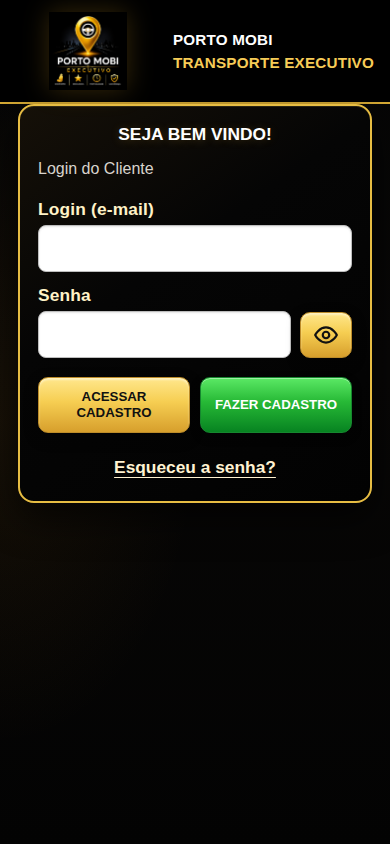

### Cadastro — preencher e revisar
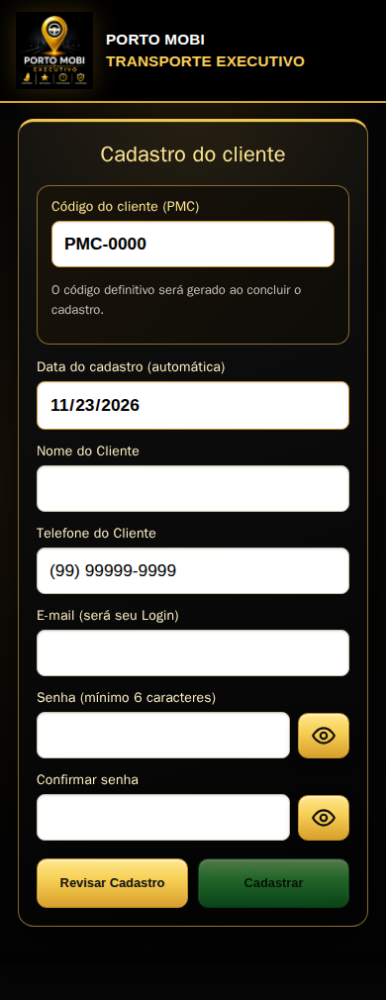

### Confirmação de cadastro — concluir ou corrigir
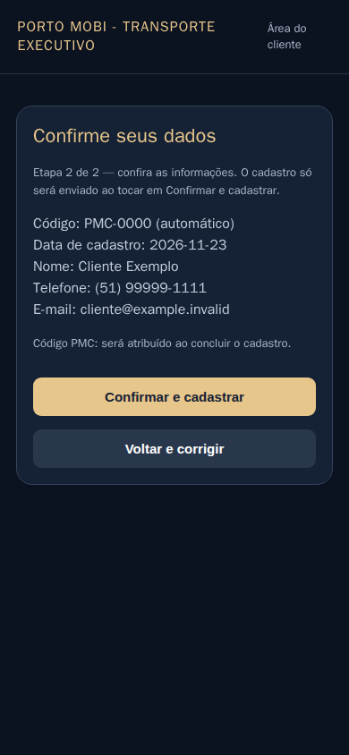

### Solicitar reserva
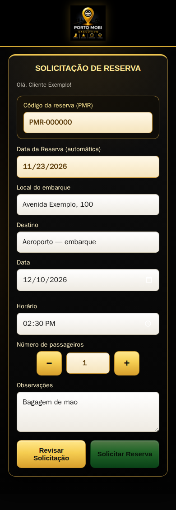

### Confirmar solicitação — enviar ou corrigir
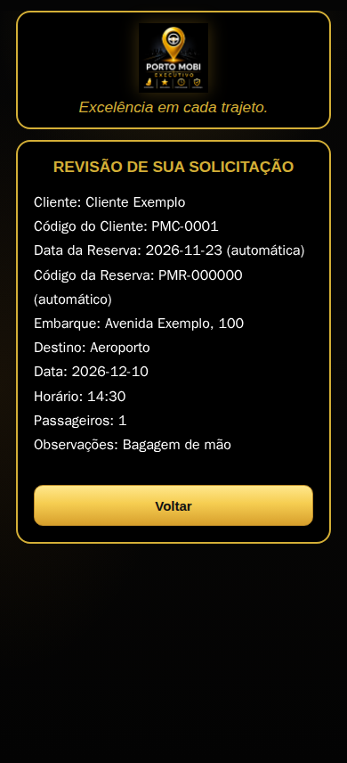

### Acompanhamento de reservas
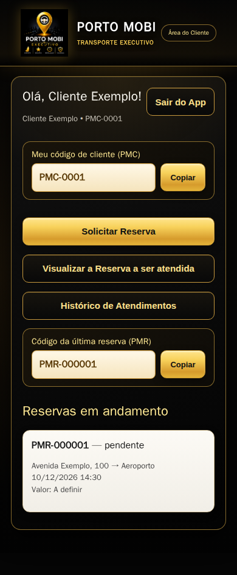

## Motorista

### Login
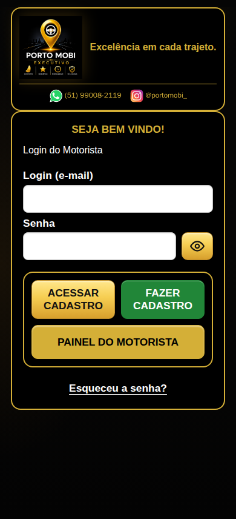

### Cadastro — preencher e revisar
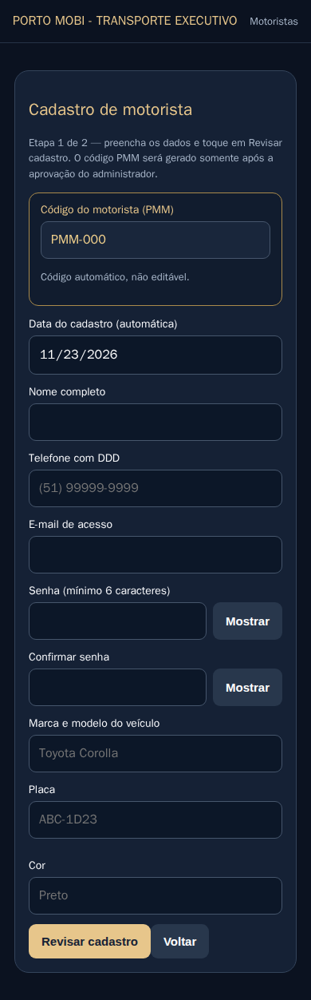

### Revisão — enviar cadastro para aprovação ou corrigir
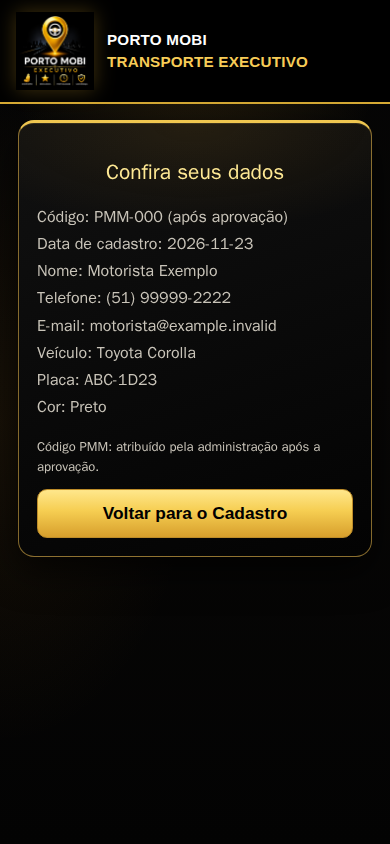

### Autorização pendente — verificar aprovação ou sair
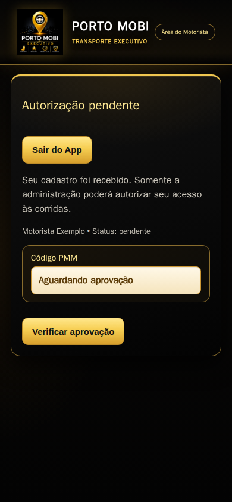

### Corridas
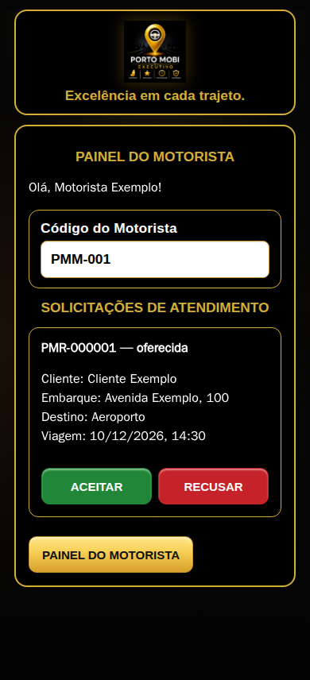

### Atendimento da Reserva: saudação ao Motorista, dados do Cliente e botão Iniciar Atendimento
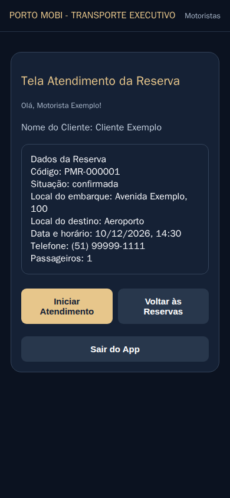

### Tela Iniciar Atendimento: avisos pelo WhatsApp e GPS ao embarque
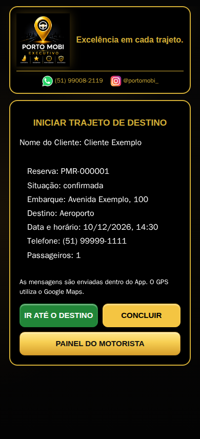

### Atendimento em andamento: GPS ao destino e conclusão
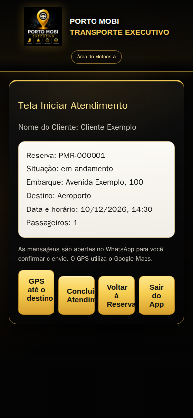

## Administração

### Login
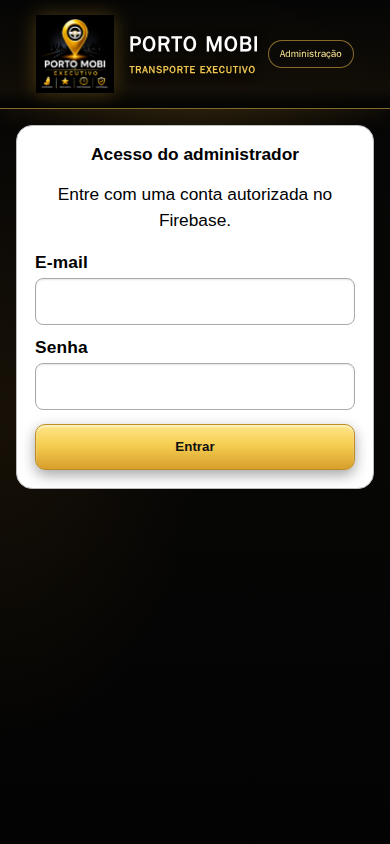

### Painel administrativo
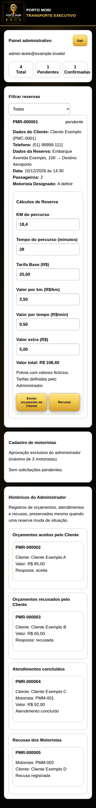

---

**Estado:** apenas revisão de aparência e comandos exibidos; cliques, autenticação, localização, WhatsApp e instalação PWA devem ser validados separadamente. Não mesclar esta ramificação com a principal antes da homologação.
